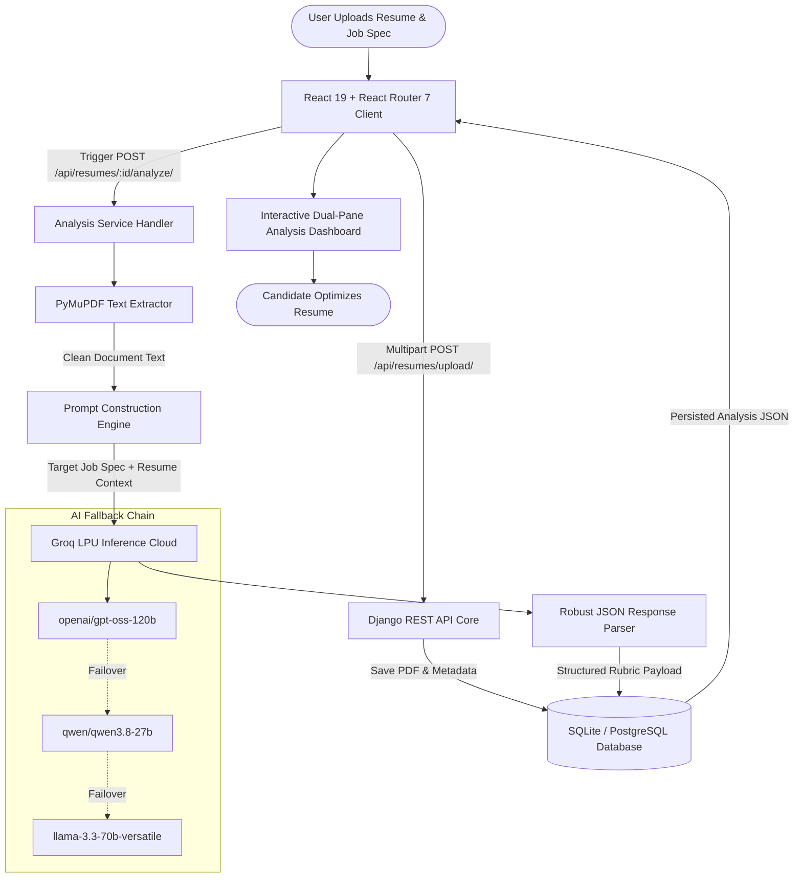

# 🎯 JobFit — AI Resume Analyzer & ATS Optimization Engine

<div align="center">


<br /><br />

[](https://github.com/Amal070/JobFit-django)
[](https://jobfit-frontend.onrender.com)
[](https://www.djangoproject.com)
[](https://react.dev)
[](https://tailwindcss.com)
[](https://groq.com)
[](https://www.python.org)
[](https://www.typescriptlang.org)
[](LICENSE)

**An enterprise-grade, privacy-first AI resume analysis and ATS scoring platform that transforms resumes into interview-winning profiles with deep rubric scoring, keyword intelligence, and actionable recommendations.**

<p align="center">
  <a href="https://jobfit-frontend.onrender.com"><strong>🚀 Explore the Live Application: https://jobfit-frontend.onrender.com »</strong></a>
</p>

[🌐 **Live Demo**](https://jobfit-frontend.onrender.com) • [⚡ **Key Features**](#-key-features) • [🏗️ **Architecture**](#-architecture) • [📊 **Scoring Engine**](#-ats-scoring--evaluation-engine) • [📡 **API Reference**](#-api-reference) • [🛠️ **Getting Started**](#-getting-started) • [⚙️ **Configuration**](#-configuration) • [🚀 **Deployment**](#-render-deployment-guide)

</div>

---

## 🌟 Overview

**JobFit** bridges the gap between ambitious job seekers and automated Applicant Tracking Systems (ATS). By combining high-speed PDF document extraction, context-aware role matching, and ultra-fast LLM inference via **Groq LPUs**, JobFit delivers instant, granular feedback on resume effectiveness before submitting to employers:

1. **High-Performance PDF Parsing**: Direct text extraction using `PyMuPDF` (`fitz`), preserving structural section boundaries, bullet hierarchies, and multi-page layout data.
2. **Context-Aware Job Matching**: Evaluates candidates directly against target company names, job titles, and job specifications to measure true role alignment.
3. **Enterprise LLM Inference via Groq**: Powered by high-speed Groq LPUs running state-of-the-art open models (`openai/gpt-oss-120b`, `qwen/qwen3.8-27b`) with automatic multi-model fallback.
4. **4-Dimensional Rubric Scoring**: Deep analysis across **Tone & Style**, **Content & Impact**, **Structure & Layout**, and **Skills & Keywords** alongside overall ATS readiness marks (0–100).
5. **Actionable Screener Guidance**: Generates contextual tips tagged by type (`good` or `improve`) accompanied by thorough explanations and suggested rewrites.
6. **Sleek Monochrome UI / UX with Dark & Light Modes**: Minimalist high-contrast aesthetic inspired by modern developer platforms, featuring seamless theme switching (Dark, Light, System) with zero flash of unstyled content.
7. **Privacy-First Sandboxed Architecture**: Scoped JWT user isolation, protected media file serving, strict `.gitignore` safety guards, and one-click data purge capabilities.

---

## ✨ Key Features

- **🎯 ATS Compatibility & Screener Simulation**:
  - Generates a holistic **0–100 ATS readiness score** based on recruiter benchmarks.
  - Simulates automated corporate screeners to identify missing critical keywords and unreadable formatting patterns.
  - Categorizes candidate competitiveness into actionable performance tiers.

- **🔍 4-Dimensional Granular Rubric**:
  - **Tone & Style**: Audits professional voice, action verbs, confidence level, and passive-voice frequency.
  - **Content & Impact**: Evaluates quantifiable metrics, revenue/efficiency metrics, and Google's "X-Y-Z" achievement formula.
  - **Structure & Layout**: Inspects section readability, heading hierarchy, chronological consistency, and whitespace balance.
  - **Skills & Keywords**: Detects missing hard skills, specialized tools, industry certifications, and domain competencies required by the job listing.

- **🌓 Monochrome Design System with Dark & Light Modes**:
  - Curated monochrome palette with high-contrast surfaces, subtle borders, and smooth transitions.
  - Complete theme persistence (`dark` / `light` / `system`) via local storage and system media queries.
  - Accessible SVG animated score gauges and interactive progress rings.

- **📄 Interactive Side-by-Side Document Inspection**:
  - Dual-pane layout on desktop pairing the native embedded PDF viewer with real-time feedback cards.
  - Mobile-responsive tab navigation enabling seamless toggling between document preview and analysis metrics.

- **⚡ Resilient Multi-Model Groq Inference Pipeline**:
  - Ultra-low latency analysis completion (typically under 2 seconds).
  - Robust multi-model failover sequence: `openai/gpt-oss-120b` ➔ `qwen/qwen3.8-27b` ➔ `openai/gpt-oss-20b` ➔ `llama-3.3-70b-versatile` ➔ `llama3-70b-8192`.
  - Resilient JSON parsing engine with markdown block stripping and bracket boundary recovery.

- **🔐 Scoped JWT Session Authentication**:
  - Secure registration, login, and token refresh using Django REST Framework Simple JWT.
  - Strict object-level permissions ensuring users can only inspect and manage their own resumes and analysis reports.

- **🧹 One-Click Privacy Purge**:
  - Dedicated `/wipe` endpoint and user interface to instantly purge all uploaded resumes, media files, and analysis records.

---

## 🏗️ Architecture

### End-to-End Analysis Pipeline

The system is designed with a decoupled architecture separating frontend presentation from backend document processing and high-throughput AI inference:



### System Component Flow

```
                      Candidate PDF Resume + Target Job Spec
                                         │
                                         ▼
                 ┌────────────────────────────────────────────────┐
                 │       React 19 + React Router 7 Client         │
                 │  - Dual Theme Provider (Dark / Light / Auto)   │
                 │  - Interactive SVG ScoreGauge & ScoreRings     │
                 │  - Dual-Pane Layout & Mobile Tab Switcher      │
                 └───────────────┬────────────────────────────────┘
                                 │
                     HTTP / JSON / JWT Authentication
                                 │
                                 ▼
                 ┌────────────────────────────────────────────────┐
                 │         Django 5.1 + REST Framework Core       │
                 │  - Simple JWT Authentication Middleware        │
                 │  - Protected Media File Streaming              │
                 │  - Resume Upload & Management ViewSets         │
                 └───────┬────────────────────────┬───────────────┘
                         │                        │
                         ▼                        ▼
                 ┌──────────────┐         ┌──────────────┐
                 │   PyMuPDF    │         │  SQLite DB   │
                 │(fitz Parser) │         │(Data Models) │
                 └───────┬──────┘         └──────────────┘
                         │
                         ▼
                 ┌────────────────────────────────────────────────┐
                 │           JobFit AI Analysis Engine            │
                 │  - Role Alignment & Gap Identification Engine  │
                 │  - Multi-Model Resilience & Auto-Fallback      │
                 │  - Robust JSON Schema Boundary Recovery        │
                 └──────────────────────┬─────────────────────────┘
                                        │
                                        ▼
                 ┌────────────────────────────────────────────────┐
                 │            Groq LPU Inference Cloud            │
                 │        (openai/gpt-oss-120b, qwen3.8-27b)      │
                 └────────────────────────────────────────────────┘
```

---

## 🎯 ATS Scoring & Evaluation Engine

### Evaluation Dimensions

Every uploaded resume is analyzed against the target job posting across four weighted criteria plus an overall calibrated readiness score:

| Dimension | Weight | Scoring Range | Evaluation Focus | Key Metrics Analyzed |
|---|---|---|---|---|
| **Content & Impact** | `30%` | 0 – 100 | Quantifiable results and achievement metrics | Google XYZ formula, numerical metrics (`%`, `$`, volume), outcome vs duty balance |
| **Skills & Keywords** | `30%` | 0 – 100 | Hard competencies and role alignment | Job description keyword overlap, core tools, frameworks, technical certifications |
| **Tone & Style** | `20%` | 0 – 100 | Communication formality and linguistic strength | Active verbs, authoritative phrasing, absence of personal pronouns, conciseness |
| **Structure & Layout** | `20%` | 0 – 100 | Visual hierarchy and ATS machine scannability | Standard section headings, chronological consistency, bullet readability, clean margins |

### ATS Screener Simulation Tiers

| Score Tier | Classification | Screener Verdict | Recommended Action |
|---|---|---|---|
| **90 – 100** | Exceptional | **Guaranteed Pass** | Ready for submission; minor polish on high-priority bullet points. |
| **75 – 89** | Strong Match | **Likely Pass** | Add 2–3 missing technical keywords to maximize ranking against top candidates. |
| **50 – 74** | Needs Revision | **Borderline Risk** | Reformat passive bullet points with quantifiable metrics and inject required tools. |
| **0 – 49** | At Risk | **Likely Filtered** | Overhaul structure, standardize headings, and align skills directly with job description. |

---

## 🛠️ Tech Stack

| Domain | Technology | Description |
|---|---|---|
| **Backend Framework** | [Django](https://www.djangoproject.com/) `v5.1+` | High-level Python web framework powering REST APIs and ORM |
| **API Architecture** | [Django REST Framework](https://www.django-rest-framework.org/) `v3.15+` | Serializers, authentication classes, and endpoint views |
| **Authentication** | [Simple JWT](https://django-rest-framework-simplejwt.readthedocs.io/) | Stateless JSON Web Token authentication with refresh rotation |
| **Document Parser** | [PyMuPDF](https://pymupdf.readthedocs.io/) (`fitz`) `v1.25+` | High-performance C-backed PDF text extraction engine |
| **Inference Engine** | [Groq LPU](https://groq.com/) | Ultra-low latency inference using open frontier models |
| **Frontend Framework** | [React 19](https://react.dev/) + [React Router 7](https://reactrouter.com/) | Client-side routing, hooks, and modern single-page architecture |
| **Styling** | [Tailwind CSS v4](https://tailwindcss.com/) | Modern CSS utility framework with semantic monochrome tokens |
| **File Ingestion** | [react-dropzone](https://react-dropzone.js.org/) | Drag-and-drop document upload with client-side MIME validation |
| **Language** | [TypeScript](https://www.typescriptlang.org/) `v5.7+` & [Python](https://www.python.org/) `3.10+` | Type-safe full stack implementation |
| **Build Tool** | [Vite](https://vitejs.dev/) `v6+` | Next-generation frontend bundler with lightning-fast HMR |

---

## 🚀 Getting Started

### Prerequisites

Ensure you have the following installed on your local environment:

- **Python**: `3.10+` (Python 3.11 or 3.12 recommended)
- **Node.js**: `18+` (or `20+` LTS) with `npm`
- **Groq API Key**: A free API key from the [Groq Console](https://console.groq.com/keys)

---

### 1. Clone the Repository

```bash
git clone https://github.com/Amal070/JobFit-django.git
cd JobFit-django
```

---

### 2. Backend Setup

1. **Navigate to the `backend/` directory:**
   ```bash
   cd backend
   ```

2. **Create and activate a Python virtual environment:**
   - **Windows (PowerShell):**
     ```powershell
     python -m venv venv
     .\venv\Scripts\Activate.ps1
     ```
   - **macOS / Linux:**
     ```bash
     python3 -m venv venv
     source venv/bin/activate
     ```

3. **Install backend dependencies:**
   ```bash
   pip install -r requirements.txt
   ```

4. **Configure environment variables:**
   Create `.env` inside `backend/` using the template:
   ```bash
   # Windows:
   copy .env.example .env
   # macOS / Linux:
   cp .env.example .env
   ```

   Populate your `backend/.env` file:
   ```env
   DJANGO_SECRET_KEY=your-secure-random-secret-key-here
   DEBUG=True
   GROQ_API_KEY=gsk_your_actual_groq_api_key_here
   GROQ_MODEL=openai/gpt-oss-120b
   ```

5. **Run database migrations:**
   ```bash
   python manage.py migrate
   ```

---

### 3. Frontend Setup

1. **Open a new terminal and navigate to `frontend/`:**
   ```bash
   cd frontend
   ```

2. **Install frontend dependencies:**
   ```bash
   npm install
   ```

---

## 💻 Running the Application

### Start the Backend Server

From the `backend/` directory (with your virtual environment activated):

```bash
python manage.py runserver
```

- Backend API root: [http://127.0.0.1:8000/](http://127.0.0.1:8000/)
- Django Admin interface: [http://127.0.0.1:8000/admin/](http://127.0.0.1:8000/admin/)

### Start the Frontend Dev Server

From the `frontend/` directory:

```bash
npm run dev
```

- Open [http://localhost:5173/](http://localhost:5173/) in your web browser.

### Build Frontend for Production

```bash
cd frontend
npm run build
```

The production-ready assets will be compiled directly to `frontend/build/client/`.

---

## 📡 API Reference

> **Base API URL:** `http://127.0.0.1:8000/api`  
> **Default Authorization Header:** `Authorization: Bearer <access_token>`

### Authentication & Identity

| Method | Endpoint | Description | Auth Required |
|---|---|---|:---:|
| `POST` | `/api/auth/register/` | Register a new user account (`username`, `password`, `email`) | No |
| `POST` | `/api/auth/login/` | Authenticate and obtain JWT `access` & `refresh` tokens | No |
| `POST` | `/api/auth/refresh/` | Exchange valid refresh token for a fresh access token | No |
| `GET` | `/api/auth/me/` | Retrieve profile information for current authenticated user | **Yes** |

### Resume Upload & Management

| Method | Endpoint | Description | Auth Required |
|---|---|---|:---:|
| `GET` | `/api/resumes/` | List all uploaded resumes and analysis summaries for current user | **Yes** |
| `POST` | `/api/resumes/upload/` | Upload a PDF resume (`file`, `job_title`, `job_description`, `company_name`) | **Yes** |
| `GET` | `/api/resumes/<id>/` | Fetch details, metadata, and cached analysis for a specific resume | **Yes** |
| `DELETE`| `/api/resumes/<id>/delete/` | Permanently remove resume, attached PDF, and analysis results | **Yes** |
| `GET` | `/api/resumes/file/<path>/` | Securely stream uploaded PDF document with JWT validation | **Yes** |

### AI Analysis Engine

| Method | Endpoint | Description | Auth Required |
|---|---|---|:---:|
| `POST` | `/api/resumes/<id>/analyze/` | Trigger Groq AI analysis on uploaded resume against target job spec | **Yes** |

#### Sample AI Analysis Response

```json
{
  "overallScore": 88,
  "ATS": {
    "score": 90,
    "tips": [
      {
        "type": "good",
        "tip": "Standard section headers (Experience, Education, Skills) detected, ensuring 100% ATS parser compatibility."
      },
      {
        "type": "improve",
        "tip": "Incorporate exact phrase 'Distributed Systems Architecture' from the job specification into the Summary section."
      }
    ]
  },
  "toneAndStyle": {
    "score": 85,
    "tips": [
      {
        "type": "good",
        "tip": "Strong action verbs utilized across all job roles.",
        "explanation": "Verbs like 'Architected', 'Spearheaded', and 'Engineered' convey executive ownership."
      }
    ]
  },
  "content": {
    "score": 86,
    "tips": [
      {
        "type": "improve",
        "tip": "Quantify latency reductions in the microservices migration bullet.",
        "explanation": "Replace 'significantly lowered API latency' with 'reduced p99 API latency by 42%'."
      }
    ]
  },
  "structure": {
    "score": 92,
    "tips": [
      {
        "type": "good",
        "tip": "Chronological structure is consistent and easily readable.",
        "explanation": "Date ranges and company names are uniformly formatted across all positions."
      }
    ]
  },
  "skills": {
    "score": 89,
    "tips": [
      {
        "type": "improve",
        "tip": "Explicitly list Docker, Kubernetes, and Redis in your Core Technologies section.",
        "explanation": "These are ranked as mandatory qualifications in the job posting."
      }
    ]
  }
}
```

---

## ⚙️ Configuration

All backend environment settings are configured in `backend/.env`:

| Variable | Default Value | Description |
|---|---|---|
| `DJANGO_SECRET_KEY` | *(Generated string)* | Unique cryptographic secret key used for Django signing |
| `DEBUG` | `True` | Set to `False` in production deployment |
| `GROQ_API_KEY` | *(Required)* | Groq Cloud API key for high-throughput inference |
| `GROQ_MODEL` | `openai/gpt-oss-120b` | Primary LLM model used for resume evaluation |
| `ALLOWED_HOSTS` | `127.0.0.1,localhost` | Comma-separated list of permitted hostnames |
| `CORS_ALLOWED_ORIGINS` | `http://localhost:5173` | Allowed frontend origin URLs for CORS requests |
| `MEDIA_ROOT` | `backend/media/` | File directory where uploaded resumes are stored locally |

---

## 🛡️ Security & Privacy

- **Strict Secrets Management**: `.gitignore` and `.dockerignore` prevent committing `.env`, virtual environments, database files, and local media.
- **Tenant Isolation**: All database queries are filtered by `request.user`. Users can never access or inspect another candidate's uploaded resumes.
- **Protected Media Endpoint**: Resume PDF files are served through an authenticated view (`/api/resumes/file/<path>/`) rather than an unprotected public media directory.
- **Data Purge Capability**: Instant one-click wipe feature allowing candidates to erase all uploaded resumes and analysis history on demand.

---

## 📂 Repository Structure

```
JobFit-AI/
├── backend/                          # Django REST Framework Backend
│   ├── accounts/                     # User authentication & JWT service
│   │   ├── migrations/               # Database migrations for accounts
│   │   ├── admin.py                  # User admin registration
│   │   ├── apps.py                   # App configuration
│   │   ├── models.py                 # User model extensions
│   │   ├── serializers.py            # User registration & profile serializers
│   │   ├── urls.py                   # /api/auth/ endpoints
│   │   └── views.py                  # Register, Login, Refresh, Me views
│   ├── analysis/                     # AI Analysis & Groq Pipeline
│   │   ├── ai_service.py             # PyMuPDF extractor, Groq client & failover
│   │   ├── apps.py                   # Analysis app configuration
│   │   ├── urls.py                   # Analysis URL routes
│   │   └── views.py                  # /api/resumes/<id>/analyze/ controller
│   ├── core/                         # Django project core configuration
│   │   ├── asgi.py                   # ASGI application entrypoint
│   │   ├── settings.py               # Settings, CORS, JWT & Groq config
│   │   ├── urls.py                   # Root URL routing table
│   │   └── wsgi.py                   # WSGI application entrypoint
│   ├── resumes/                      # Resume persistence & media handling
│   │   ├── migrations/               # Database migrations for resumes
│   │   ├── admin.py                  # Resume admin interface
│   │   ├── apps.py                   # Resumes app configuration
│   │   ├── models.py                 # Resume & Analysis database models
│   │   ├── serializers.py            # Resume upload & detail serializers
│   │   ├── urls.py                   # /api/resumes/ routes
│   │   └── views.py                  # Upload, detail, delete & file streaming
│   ├── .env.example                  # Template configuration variables
│   ├── manage.py                     # Django management script
│   └── requirements.txt              # Pinned Python dependencies
├── frontend/                         # React 19 + React Router 7 Frontend
│   ├── app/
│   │   ├── components/               # Modular UI Components
│   │   │   ├── ATSBreakdown.tsx      # ATS compatibility summary & tips
│   │   │   ├── CategoryCard.tsx      # Rubric dimension cards with reasoning
│   │   │   ├── DetailsTab.tsx        # Tabbed rubric detail inspector
│   │   │   ├── Footer.tsx            # Global footer component
│   │   │   ├── Navbar.tsx            # Header with navigation & theme toggle
│   │   │   ├── ScoreCard.tsx         # Score metric card with indicators
│   │   │   ├── ScoreGauge.tsx        # Animated circular SVG score gauge
│   │   │   └── SummaryTab.tsx        # High-level score overview tab
│   │   ├── routes/                   # Application Pages & Route Handlers
│   │   │   ├── auth.tsx              # Monochrome Login / Register portal
│   │   │   ├── home.tsx              # Landing page with hero, features & preview
│   │   │   ├── resume.tsx            # Dual-pane PDF & analysis studio
│   │   │   ├── upload.tsx            # Drag-and-drop resume upload page
│   │   │   └── wipe.tsx              # One-click data purge utility
│   │   ├── app.css                   # Tailwind v4 semantic monochrome tokens
│   │   └── root.tsx                  # Root layout & theme hydration wrapper
│   ├── lib/
│   │   ├── api.ts                    # Axios API client with JWT interceptors
│   │   └── theme.tsx                 # Dark / Light / System theme context
│   ├── public/                       # Static public assets & icons
│   ├── package.json                  # React 19, React Router 7, Vite dependencies
│   ├── tsconfig.json                 # TypeScript compiler configuration
│   └── vite.config.ts                # Vite & Tailwind CSS v4 bundler config
├── .dockerignore                     # Docker build exclusion rules
├── .gitignore                        # Comprehensive Git security filters
└── README.md                         # Project documentation
```

---

---

## 🚀 Render Deployment Guide

JobFit is fully pre-configured for seamless production deployment on [Render](https://render.com).

> 🌐 **Live Deployed Application**: [https://jobfit-frontend.onrender.com](https://jobfit-frontend.onrender.com)

```
┌────────────────────────────────────────────────────────────────────────┐
│                        Render Production Architecture                  │
├────────────────────────────────┬───────────────────────────────────────┤
│ Frontend (Static Site)         │ React Router 7 SPA (Vite, Tailwind v4)│
│ Backend (Web Service)          │ Django 5.2 + Gunicorn + WhiteNoise    │
│ Relational Database            │ Render Managed PostgreSQL             │
│ AI Inference Engine            │ Groq Cloud LPUs (gpt-oss-120b)        │
│ Persistent Storage (Optional)  │ AWS S3 / Cloudflare R2 / Render Disk  │
└────────────────────────────────┴───────────────────────────────────────┘
```

---

### Method 1: Automated Blueprint Deployment (`render.yaml`)

The repository includes a ready-to-use [`render.yaml`](./render.yaml) file defining the entire infrastructure.

1. **Push your code to GitHub**:
   ```bash
   git add .
   git commit -m "chore: prepare for Render production deployment"
   git push origin main
   ```
2. **Log in to [Render Dashboard](https://dashboard.render.com/)**.
3. Click **New +** ➔ **Blueprint**.
4. Connect your GitHub repository (`JobFit-django`).
5. Render will automatically detect `render.yaml` and configure:
   - **`jobfit-db`** (PostgreSQL Database)
   - **`jobfit-backend`** (Python Web Service)
   - **`jobfit-frontend`** (Static Site with SPA rewrite rules)
6. Supply the required secret when prompted:
   - `GROQ_API_KEY`: Your Groq API key from [console.groq.com](https://console.groq.com).
7. Click **Apply**. Render will provision and deploy all services simultaneously.

---

### Method 2: Manual Service-by-Service Deployment

If you prefer to configure each service manually in the Render dashboard:

#### Step 1: Create a PostgreSQL Database
1. Go to **Dashboard** ➔ **New +** ➔ **PostgreSQL**.
2. **Name**: `jobfit-db`
3. **Database**: `jobfit`
4. **User**: `jobfit_user`
5. **Plan**: `Free`
6. Click **Create Database**.
7. Once created, copy the **Internal Database URL** (e.g. `postgresql://...`).

#### Step 2: Deploy the Django Backend Web Service
1. Go to **Dashboard** ➔ **New +** ➔ **Web Service**.
2. Connect your GitHub repository.
3. Configure the settings:
   - **Name**: `jobfit-backend`
   - **Root Directory**: `backend`
   - **Runtime**: `Python 3`
   - **Build Command**: `./build.sh`
   - **Start Command**: `gunicorn core.wsgi:application`
   - **Plan**: `Free`
4. In **Advanced** ➔ **Health Check Path**: `/health/`
5. Add the following **Environment Variables**:

| Variable | Recommended Value | Notes |
|:---|:---|:---|
| `PYTHON_VERSION` | `3.11.9` | Ensures compatible Python runtime |
| `DEBUG` | `False` | Disables debug mode in production |
| `SECRET_KEY` | *(Auto-generate or 50+ random chars)* | Keep this secure |
| `DATABASE_URL` | *(Paste Internal Database URL from Step 1)* | Connects PostgreSQL |
| `ALLOWED_HOSTS` | `.onrender.com,localhost,127.0.0.1` | Permits Render domains |
| `GROQ_API_KEY` | `gsk_...` | From [console.groq.com](https://console.groq.com) |
| `GROQ_MODEL` | `openai/gpt-oss-120b` | High-accuracy inference model |
| `CORS_ALLOW_ALL_ORIGINS`| `False` | Restricts CORS in production |
| `CORS_ALLOWED_ORIGINS` | `https://your-frontend.onrender.com` | Update with your frontend URL |
| `CSRF_TRUSTED_ORIGINS` | `https://*.onrender.com` | Permits HTTPS CSRF checks |

6. Click **Create Web Service**. Wait for the build and migration to succeed.
7. Copy your backend URL: `https://jobfit-backend.onrender.com`.

#### Step 3: Deploy the React Frontend Static Site
1. Go to **Dashboard** ➔ **New +** ➔ **Static Site**.
2. Connect your GitHub repository.
3. Configure the settings:
   - **Name**: `jobfit-frontend`
   - **Root Directory**: `frontend`
   - **Build Command**: `npm install && npm run build`
   - **Publish Directory**: `build/client`
4. Add the **Environment Variable**:
   - `VITE_API_BASE_URL`: `https://jobfit-backend.onrender.com/api` (use your actual backend URL from Step 2)
5. **Critical for SPA Client-Side Routing**:
   - In the frontend service settings, scroll to **Redirects / Rewrites**.
   - Add rule:
     - **Type**: `Rewrite`
     - **Source**: `/*`
     - **Destination**: `/index.html`
   *(This prevents 404 errors when refreshing `/resume/:id`, `/upload`, or `/auth`).*
6. Click **Create Static Site**.
7. Once deployed, copy your frontend URL (e.g. `https://jobfit-frontend.onrender.com`) and add it to `CORS_ALLOWED_ORIGINS` on your backend service.

---

### 🛡️ Production Security & Persistent Storage

- **Ephemeral Storage Notice**:
  Render's Free Tier web services use an ephemeral filesystem. Files saved to disk are cleared on restart.
  - For full enterprise production, connect external persistent object storage:
    - **AWS S3** or **Cloudflare R2** via `django-storages` + `boto3`.
    - Alternatively, attach a **Render Persistent Disk** (`/var/data`) on paid Render instances.
- **Access Isolation**:
  The application enforces scoped JWT ownership so candidates can never inspect, analyze, or delete resumes belonging to other users.

---

### 🩺 Verifying Live Deployment

1. **Backend Health Check**:
   Visit `https://your-backend.onrender.com/health/` in your browser. Expected response:
   ```json
   {
     "status": "ok",
     "service": "jobfit-ai-backend",
     "database": "connected"
   }
   ```
2. **Frontend Connectivity**:
   Open [https://jobfit-frontend.onrender.com](https://jobfit-frontend.onrender.com). Create an account, upload a test PDF resume, and verify that ATS scoring completes within 2–4 seconds.

---

### ⚠️ Common Troubleshooting

| Issue | Cause | Fix |
|:---|:---|:---|
| **CORS error in browser console** | Frontend domain not in `CORS_ALLOWED_ORIGINS` | Add `https://your-frontend.onrender.com` to backend environment variables (no trailing slash). |
| **404 error when refreshing page** | Static site missing SPA rewrite rule | Add Render rewrite rule `/*` ➔ `/index.html` in Static Site settings. |
| **`DisallowedHost` error** | Render host not recognized | Ensure `ALLOWED_HOSTS` includes `.onrender.com`. |
| **`GROQ_API_KEY is not configured`** | Missing secret in backend service | Set `GROQ_API_KEY` in Render backend Environment tab. |
| **Static files (CSS/admin) missing** | `collectstatic` did not run | Verify `backend/build.sh` executed `python manage.py collectstatic --no-input`. |

---

## 📄 License

This project is licensed under the **MIT License**. See the [LICENSE](LICENSE) file for details.

<div align="center">
Made with ❤️ by <a href="https://github.com/Amal070">Amal</a>
</div>
